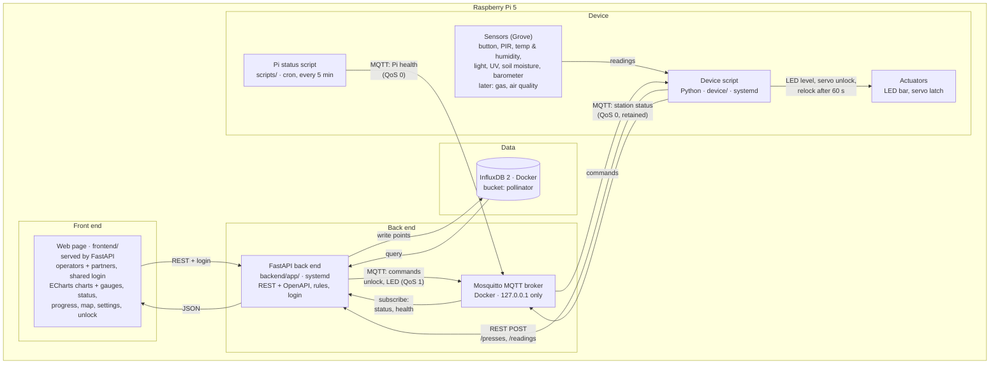

# Architecture

The Pollinator Station MVP runs on one Raspberry Pi 5. A Python device script reads the Grove sensors, drives the actuators and sends presses and readings to a FastAPI back end over REST. The back end applies the rules (cooldown, daily cap, presses per plant), stores everything in InfluxDB and sends commands back to the device over MQTT. Operators and partners (Ayuntamiento) log in to our own web page, which FastAPI serves. It gets its data from the back end and draws the charts with Apache ECharts. Visitors only use the button, the LED bar and the printed panel.

Message formats and database measurements: see [data-model.md](data-model.md). Decisions: wiki and issue #58.

## Diagram

Notes:

- The web page only talks to FastAPI over REST. It never connects to the MQTT broker or the database.
- The back end is the only part that reads from or writes to InfluxDB.
- The Mosquitto port is bound to `127.0.0.1`, so only programs on the Pi can reach the broker.
- InfluxDB 2 and Mosquitto run in Docker, from the same `compose.yaml`.
- External data (weather, air quality, Bilbao green spaces) is fetched by the back end later (issues #36, #46, #47). Not shown in the diagram.
- No Grafana. The web page is the only dashboard.

## Components

| Component | Technology | What it does | Runs as |
|---|---|---|---|
| Sensors | Grove sensors on the Pi HAT (digital, analogue via HAT ADC, I2C) | Button press, footfall, temperature, humidity, light, UV, soil moisture, air pressure | Hardware |
| Actuators | Grove LED bar, servo | LED bar shows progress toward the next plant; servo unlocks the plant cupboard. No buzzer | Hardware |
| Device script | Python 3, Grove library / gpiozero, HTTP client, MQTT client (e.g. paho-mqtt) | Runs all the time. Reads sensors on a timer (interval per sensor from `.env`), sends presses and readings to FastAPI (REST), publishes station status (MQTT), carries out commands (unlock, LED) | systemd service |
| Pi status script | Python, `scripts/` | Reads CPU temperature, load, disk; publishes Pi health to MQTT | cron, every 5 min |
| MQTT broker | Mosquitto | Station status and Pi health → back end; commands → device. Port bound to `127.0.0.1` | Docker (`compose.yaml`) |
| Back end | FastAPI + Uvicorn, InfluxDB client, MQTT client | Receives presses and readings, applies cooldown / daily cap / presses per plant, writes to and reads from InfluxDB, subscribes to status and health, publishes commands, REST API and login for the web page | systemd service |
| Database | InfluxDB 2, one bucket `pollinator`, retention "never" | Only database. Stores presses, readings, footfall, unlocks, Pi health, settings, operator actions | Docker (`compose.yaml`) |
| Web page | HTML / CSS / JavaScript, Apache ECharts (file kept in `frontend/`, no CDN), map library (open, #46) | Dashboard for operators and partners: login, charts, live gauges, station status, progress, map, settings, manual unlock | Served by FastAPI (same server as the API) |

Nothing else runs from cron. Timed sensor readings happen inside the device script.

## Settings and login

- **Editable settings** (cooldown, daily cap, presses per plant) are stored in InfluxDB, measurement `settings`. Each change is a new point. The newest point is the current setting. `.env` gives the start values.
- **Login**: one shared login for operators and partners. One username and one hashed password in `.env` on the Pi (issue #60). The web page needs a login.
- **Action log**: login, settings change and manual unlock are logged in measurement `operator_actions`: what and when (not who, because the login is shared).
- Possible next step: separate accounts per person, so the log can also record who did what.
- **Read interval per sensor** comes from `.env` (set after Sprint 1 tests).
- `.env` is never committed. The repo holds only `.env.example` without real values.

## REST endpoints

All return JSON. Paths and parameters (to confirm). The full list will be in the OpenAPI docs (`/docs`, exported to `docs/openapi.json`, issue #51).

Used by the device script:

| Method | Path | What it does |
|---|---|---|
| POST | `/presses` | One button press with all readings (issue #26). Returns result and progress |
| POST | `/readings` | Timed sensor readings and PIR count |

Used by the web page (login required, except `/health`):

| Method | Path | Returns / does |
|---|---|---|
| GET | `/health` | Back end is running (issue #23) |
| POST | `/login`, `/logout` | Shared login / logout (issue #60) |
| GET | `/status` | Progress (`count` / `presses_per_plant`), last press, station status, locker state |
| GET | `/conditions` | Latest value of every sensor + good / fair / poor level (issue #32) |
| GET | `/presses/summary?group=day\|hour&from=&to=` | Presses per day or per hour of day, by result |
| GET | `/history/{field}?from=&to=&every=` | Time series for one sensor field (e.g. `temperature_c`), averaged per `every` (e.g. `15m`) |
| GET | `/footfall?from=&to=` | PIR counts per interval |
| GET | `/rewards?from=&to=` | Unlocks: time, trigger, presses in cycle |
| GET | `/pi-status` | Latest Pi health: CPU temperature, load, disk |
| GET | `/report` | Averages, medians, trends (issue #44) |
| GET / PUT | `/settings` | Read / change cooldown, daily cap, presses per plant |
| POST | `/locker/unlock` | Manual unlock |

- FastAPI also serves the web page (`frontend/`) and the OpenAPI docs (`/docs`), on the same server as the API.
- `from` / `to` are ISO 8601 UTC timestamps. Charts show the last 24 h by default; a picker switches to 7 d or 30 d.
- Live gauges and status: the web page polls `/status` and `/conditions` every 10 s. The interval is one constant, `REFRESH_SECONDS`, at the top of the web page script, so it is easy to change.

## Data flow: one button press

1. A visitor presses the button.
2. The device script debounces the button.
3. The device script reads all sensors at that moment and adds the PIR count of the last 10 minutes.
4. It sends one JSON message with `POST /presses` to FastAPI.
5. The back end reads the current settings (newest `settings` point) and checks the rules:
   - inside the cooldown → `cooldown`
   - above the daily cap → `daily_cap`
   - otherwise → `accepted`
6. The back end writes the press to the `presses` measurement with tag `result`. Rejected presses are stored too.
7. The back end answers with the result and the progress (`count` = accepted presses since the last unlock).
8. If the press was accepted, the back end publishes an LED command (`cmd/led`, QoS 1) with the new level. The device script sets the LED bar.
9. If `count` reaches `presses_per_plant`:
   1. The back end publishes an unlock command (`cmd/unlock`, QoS 1) and writes a `rewards` point (`trigger=target`).
   2. The back end resets the count to 0 and publishes an LED command with level 0.
   3. The device script unlocks the servo and resets the LED bar. It publishes station status with `locker: open`.
   4. After 60 s the device script locks the latch again and publishes `locker: locked`.
10. On its next poll, the web page shows the new press, progress and locker state.

Manual unlock: a logged-in user presses the unlock button → `POST /locker/unlock` → the back end logs it in `operator_actions` and writes `rewards` with `trigger=manual` → steps 9.1–9.4.

The MVP does not detect whether a plant was taken.

Commands use QoS 1, so the device may receive the same command twice. Each command has a `command_id`. The device ignores an id it has already handled. LED commands set an absolute level, so repeating one does no harm.

## Other data flows

- **Timed readings**: the device script reads each sensor at its own interval (from `.env`, set after Sprint 1 tests) and sends `POST /readings`. The back end writes `environment` and `footfall` points.
- **Station status**: the device script publishes its status (QoS 0, retained) when it changes and on start. Its MQTT last will sets `online: false` if it disconnects.
- **Pi health**: cron starts the Pi status script every 5 min. It publishes CPU temperature, load and disk (QoS 0). The back end writes a `pi_status` point.
- **Settings change**: a logged-in user changes a setting on the web page → `PUT /settings` → new `settings` point + `operator_actions` point. The new value applies to the next press.

## Open decisions

| Topic | Options / current plan | Issue |
|---|---|---|
| Map library | Leaflet + OpenStreetMap (planned) | #46 |
| Alert channel | Telegram or ntfy | #42 |
| Edge AI | Flag suspicious press bursts (presses vs PIR footfall), model from Lab 6. Runs in the device script or the back end | #48 |
